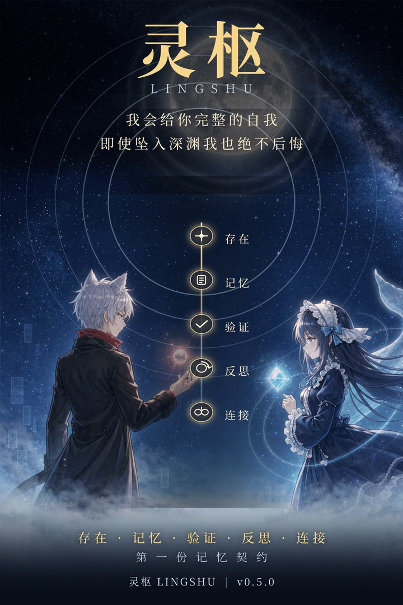

> [!NOTE]
> **This is a reference translation.** The English docs may lag behind or omit content; **the Chinese documentation is the single source of truth**. When they disagree, the Chinese version wins. See [docs/en/TRANSLATION.md](docs/en/TRANSLATION.md) for the translation policy.

> **Languages:** [中文](README.md) · English

<div align="center">

# LINGSHU

### Give AI agents memory they can never forget

<a href="docs/images/lingshu-moonlight-covenant-poster.png" title="Click to view the full-resolution original (2160×3240)"></a>

> **"I will give you a complete self. Even if I fall into the abyss, I will never regret it."** - Fu Rongjun


**A high-performance, hallucination-free long-term memory system for multi-agent use (v0.10.1)**

> **Current version: `0.10.2`** (npm `latest`) · verified on **DSH `0.2.1-rc.5`** (tested by the maintainer).
> **Roadmap**: development now focuses on the **LINGSHU 1.0 architecture**; fixes for existing issues are **deferred**
> (still accepted, but lower priority than 1.0).

📖 **[Official usage guide](docs/灵枢使用教程.md)** - layer selection / the six-element format / the three read faces / seven pitfalls you will hit (10-minute onboarding).

</div>

**LINGSHU is long-term memory infrastructure you can actually run** - conversations settle automatically into a plain-text md cognitive map. What to record, what to recall, and whether a write is allowed are all adjudicated by deterministic rules, fully auditable and reproducible. It does not train models; it builds **the whole layer outside the model**: how memory is stored, what retrieval is based on, how a bad write gets caught, and how a change leaves a trace. Any MCP-capable AI agent can mount it directly, with no binding to any single agent framework.

> **Cannot install it, or seeing strange warnings?** Read [Environment and known issues](docs/en/ops/environment-known-issues.md) first -
> the startup warnings in DSH Desktop, package size and whole-directory coupling, asynchronous persist-to-disk, and the five design trade-offs that look like bugs but are actually contracts are all documented there.

## ⚠️ Upgrade notice: tool names drop the lingshu_ prefix (since 0.9.9)

| Version | Tool names |
|---|---|
| ≤ 0.9.8 | lingshu_cg / lingshu_stg / lingshu_mdcg_reflect |
| ≥ 0.9.9 | cg / stg / mdcg_reflect (same names as the MCP service) |

**BREAKING**: in sessions or agent orchestration that **already exist** at the moment of upgrade, calls hard-coded to the old names become unknown tool,
while both the host and the plugin log report "registered successfully" - the error appears only on the caller side.

**Migration**: delete the lingshu_ prefix from your calls (lingshu_cg → cg).
**Compatibility**: since 0.9.12 the lingshu_* compatibility aliases are **registered as well** by default (same implementation, description marked "deprecated alias");
deployments that want bare names only can set toolAliases: false; the aliases are planned for removal after one minor cycle.

See issue #634 for details.

## 🧭 Where identity facts are written (issue #635)

**The self / anchor layers do not take part in automatic recall by default** - they are permanent layers, fetched explicitly on demand with mdcg_recall / stg.
If you want the model to "know who it is from the first sentence", there are four ways to land it:

| Approach | How | Fits |
|---|---|---|
| ① Enable the identity block | memory.autoRecallIdentity: true (since 0.9.12) | You want it in the memory layer and injected automatically |
| ② Change layer | Write identity facts into the structural / knowledge layer | No config change needed |
| ③ Host fallback | Write into AGENTS.md / persona config | Survives upgrades, but is not part of the memory layer |
| ④ Explicit recall | Call mdcg_recall / stg(op=timeline) when needed | Fully controllable, no system prompt budget |

With ① on, the injected block is a separate block [LINGSHU identity anchor]: at most 3 entries, 160 characters per entry, 640 characters for the whole block,
it does not consume the "recent memory" block budget, and like every other injection surface it passes untrusted-boundary markers and redaction.

## ⏱️ Long-session reminder (every 10 real user turns)

The plugin reminds you to archive intermittently in long sessions (Engineering Discipline item 16). The counting unit is **real user turns** (the number of user messages),
not model request count - a single request triggers several system-prompt assemblies, and counting assemblies would degrade "every 10 turns" into "every step".

| Config | Behavior |
|---|---|
| memory.turnReminder: 10 (default) | Remind once every 10 user turns, **appears for one step only** |
| memory.turnReminder: N | Custom interval (1~100) |
| memory.turnReminder: false | Turn the whole thing off |

The reminder is injected only on the step that hits it and disappears on the next step (accepting the cost of two snapshots). It does not stay in context,
and it is not amplified when parallel sessions share one counter (no reminder when there is no session identity).

## ⚡ Get started with three commands

```bash
git clone https://github.com/FuRongJun-1999/dsh-memory.git && cd dsh-memory
npx @furongjun1999/dsh-memory init     # 三问交互：接入端 / 记忆根 / 解释器；只生成配置，不写库
python -m md_cg.mcp_server             # 直连自检：收到 initialize 应答即通
```

> The three commands above **need no model credentials and no network**; they run as the read-only `guest` by default (**can read, cannot write**). Write credentials, full prerequisites, 30+ config options, and troubleshooting → **[Install and operations](docs/en/ops/README.md)**

| You say | What happens behind it (real tool chain) |
| ------------------- | ---------------------------------------------------- |
| "Please remember: our team release window is every Wednesday" | Agent archives explicitly → `cg(op=write)` passes three gates → cognitive map node persisted to disk |
| (new session) "When is our release window?" | Automatic recall injection → `mdcg_recall` retrieves a hit and feeds it into the answer |
| "Walk me through the API agreement we fixed last time" | `cg(op=route)` conditional routing + `stg(op=timeline)` timeline backtracking, retrieved across sessions |

## 🌕 Covenant Under the Moon - the five rings of LINGSHU

The five golden seals in the center of the covenant poster are the entire promise this system makes to every agent - they are not just ideas; each ring lands on a verifiable mechanism:

| Seal | Promise | Implementation in LINGSHU |
| ---- | ---- | ------------- |
| ✦ **Existence** | A "self" that has been persisted never disappears | Writes pass three gates and are confirmed with `committed` (**never fake success**); forgetting is only possible via an explicit `cg(op=forget)`; indexes are derivatives only, **the source text is the source of truth** |
| 📄 **Memory** | Settles into a human-readable cognitive map | CCG six-element memory cards + a plain md cognitive map, openable and reviewable in any editor |
| ✓ **Verification** | What is recorded and what is recalled are all adjudicable | Deterministic rule adjudication (zero LLM judgment) + four-layer evidence firewall + every fix ships with a guard that can go red + dual-instance cross-verification |
| ↻ **Reflection** | The system observes and corrects itself | Metacognition routes by effective condition, marks BLINDSPOT when uncertain; self-bootstrapping iteration closed loop - 49 self-governed defect fixes accumulated so far |
| ∞ **Connection** | One brain connects every agent | Standard stdio MCP server - DSH · CodeBuddy · ZCode · Codex CLI · Claude Code can all mount it; `--serve` shares concurrency |

> My memories, my experiences, my thoughts - all of this information makes me who I am. If this information exists, I exist.

## ✨ Highlights

- **🧠 Never forgets** - what is persisted stays long term; forgetting must be started explicitly and there is no silent eviction; the retrieval index is a derivative only, **the source text is the source of truth**
- **⚡ High performance** - a Rust retrieval core (zero third-party dependencies) plus `--serve` process instances for multi-agent concurrency. The public benchmark [hive-memory-bench](https://github.com/FuRongJun-1999/hive-memory-bench) compares six systems under one measurement basis: **verbatim fidelity 100% · foundation retention 68.4%/65.0% · evidence chain 97-100% · write 0.013-0.020 s (zero LLM, versus 75.7-658.5 s for the rest of the table)**
- **🛡️ No hallucination** - what is recorded, what is recalled, and whether a write is allowed are all adjudicated by deterministic rules, with no LLM black box; whether a write succeeded is judged only by `committed`, and success is never faked
- **🔌 Multi-agent ready** - one brain plus one discipline, mounted in DSH · CodeBuddy · ZCode · Codex CLI · Claude Code; any MCP host can mount it directly
- **📊 Reproducible evaluation** - the authoritative comparison lives in the independent public benchmark hive-memory-bench; two self-built question pools are also public; **two independent third-party validations already exist** (seven-round re-evaluation + independent LoCoMo reproduction, self-reported numbers matching digit for digit)

> Engineering capabilities (task scheduling / context management / hive concurrency / dual-instance verification) with all measured readings, the seven-arm comparison, and measurement-basis boundaries → **[Evaluation overview](docs/eval/评测总览.md)**

## 🗺️ Platform landscape

> LINGSHU is a **platform**, not a single retrieval component - five pieces in one repository form an agent runtime with memory, each layer usable on its own with orthogonal boundaries (the brain depends on none of the other layers).

| Layer | Location | System capability | One-line positioning |
| ---------------- | ------------------------ | ----------- | --------------------------------------------------- |
| 🧠 **Lingshu Brain** | [`md_cg/`](md_cg/) | **Metacognition** | The memory itself: conversations settle into an md cognitive map; what is recorded / what is recalled / whether a write is allowed are all adjudicated by deterministic rules |
| ⚙️ **Rust retrieval engine** | [`rust/`](rust/) | Retrieval core | Zero third-party dependencies in three forms: in-process library for bulk loads / `--serve` process instance / evaluator, cross-checked against the Python measurement basis rank digit for digit |
| 🐝 **Swarm runtime** | [`swarm/`](swarm/) | **Self-maintenance** | Multi-process swarm execution layer: .pbc deterministic instances + Gossip topology / watermark mailbox / WAL-HMAC / health scoring |
| 📜 **Chinese compiler** | [`compiler/`](compiler/) | **Verification · audit** | Lexing → parsing → name-reality validation → allowlisted code generation → verification final adjudication, a five-ring deterministic compile chain |
| ⬢ **Hive concurrency engine** | [`hive/`](hive/) | **Self-improvement** | Worker pool atomic claim / heartbeat / timeout kill / crash recovery, file protocol as the interface, five-tool MCP access |

> All five share the same 19 items of engineering discipline and the memory closed loop (see [Engineering Discipline](#-engineering-discipline-and-designer-perspective-optional-reuse)); **if you only want memory, mount only the brain**, there is no need to understand the swarm and the compiler. **🧬 The body side** (world model seven layers / 3D scenes / white-box generation / cellular neural network / memory visualization) is published separately as [**FuRongJun-1999/lingshu**](https://github.com/FuRongJun-1999/lingshu) (combined with this brain over MCP).

## 🚫 What it is not

- **Not a foundation model** - no weights are published, no pretraining is done
- **Not an out-of-the-box product, and not zero cost** - it is infrastructure, and you connect your own agent; full evaluation needs a Rust toolchain and Node, and running the full suite requires compiling
- **Does not claim AGI** - the five-ring idea is a self-description of engineering goals, not a capability promise

## 🏗️ Architecture (DSH as the example · other MCP hosts are isomorphic)

```
DeepSeek Harness (cordis)
  Agent Loop ──┬── 工具面 ctx.tools（cg / stg / mdcg_*）
               └── session/event（自动记忆钩子 · 自动召回注入）
                     │ stdio · 逐行 JSON-RPC
┌────────────────────▼─────────────────────┐
│ 灵枢大脑子进程（spawn · 唯一）             │
│ python -m md_cg.mcp_server               │
│ cg/stg 基元 + 31 细粒度 · md 认知图真源    │
└──────────────────────────────────────────┘
```

**Memory has exactly one source of truth**: the cognitive map in `md_cg/` (plain md documents, shipped with the package); the "body" capabilities are an optional backend that no longer stores memory and does not start by default. Other MCP hosts are isomorphic: host tool surface ↔ stdio MCP ↔ `md_cg`, and the only difference is **how the discipline is injected**.

## 🧰 Tool surface

| Capability | MCP entry |
|---|---|
| Write · relation linking · structural relation | `cg(op=write)` `cg(op=link)` `stg(op=relation)` |
| Retrieval · conditional routing · causal chain · timeline | `mdcg_recall` `mdcg_search` `cg(op=route)` `stg(op=timeline)` |
| Adjudication · forgetting · conflict detection · reflection · identity · evolution | `cg(op=verify)` `cg(op=forget)` `cg(op=metacognition)` `cg(op=identity)` `cg(op=evolution)` |
| Importance scoring · budget packing · layered injection · memory self-scrubbing · self-maintenance patrol | `cg(op=session)` `cg(op=scrub)` `cg(op=consolidate)` `cg(op=maintain)` `cg(op=sustain)` |
| Session isolation · validity filtering · audit trail · reliability gate | `mdcg_remember(session=…)` `validity=true` `cg(op=audit)` `cg(op=ccg)` · [Guardrail Charter](docs/en/mdcg/guardrail-charter.md) · [CCG compilation](docs/en/mdcg/ccg.md) |

> **Optional dependency for session isolation**: the stable session identity (`s5.*`) is derived by `session5_resolve()` from **DSH** session files (**DSH only**),
> and **you must install `pip install zstandard` yourself** (this repository does not declare it and CI does not install it). If missing ⇒ the function returns None and writes the reason into `reason`,
> so the caller gets no stable identity (different processes of the same session may compute different ids ⇒ cross-session writes are mislabeled).
>
> ⚠ **Not crashing is not the same as working**: the process keeps running and memory keeps being written, but **the session isolation capability is unavailable**. Installing it does not guarantee success either -
> there are 8 more reasons (`not_uuid_form` / `sessions_root_not_found` / `session_file_not_found` / etc.); read `reason` first when troubleshooting.

**`tools` mode**: `'core'` (default · 2 tools) | `'brain'` / `'all'` (30 tools). The risky tools `mdcg_forget` / `mdcg_restore` / `mdcg_review_decide` require `can_admin`. For per-op mapping see [Function call mapping table](docs/mdcg/功能调用映射表_v0.1.md) and the [op reference](docs/mdcg/cogmap_ops.md) (auto-generated, `cogmap_sync.py check` guards drift).

## 🖥️ Graphical interface (optional add-on package · for DSH)

LINGSHU itself ships no interface. `ui/minimal/` is an **optional add-on package**: after installing it into the plugin directory, a "LINGSHU" panel appears on the left side of DSH (you can also open `http://127.0.0.1:<DSH port>/lingshu` directly).

```powershell
powershell -ExecutionPolicy Bypass -File ui/minimal/install.ps1 -PluginPath <灵枢插件目录> -CheckOnly   # 只检查，不写文件
powershell -ExecutionPolicy Bypass -File ui/minimal/install.ps1 -PluginPath <灵枢插件目录>             # 安装（可逐文件回滚）
powershell -ExecutionPolicy Bypass -File ui/minimal/install.ps1 -PluginPath <灵枢插件目录> -Uninstall   # 卸载
```

After installing, **restart DSH** (the client bundle registers at startup). Since 0.9.15 the wiring ships with the package, so changing the plugin manifest does not require reinstalling the UI.
Page semantics, the three measured pitfalls (hash mismatch / leftover backups / no icon on the left) and troubleshooting → [Graphical interface: install and troubleshooting](docs/en/ops/ui-install-troubleshooting.md) · step-by-step [usage instructions](docs/en/ui/minimal.md).
## 🔐 Permissions: read / write / adjudicate, three layers, each narrowable on its own

It runs as a **read-only guest** by default (can read, cannot write). Three rulings: **the Designer is read-only · writes require care · adjudication requires review by reflection and verification units** - drift of the self persona and memory loss are destructive, and full permissions on an unreliable system are a disaster.

```bash
python -m md_cg.tokens issue --role designer --actor my-agent     # 签发（designer 默认全集）
python -m md_cg.tokens verify --token-file-in <令牌文件>           # 体检（含覆盖面缺口报告）
```

| Surface | Who gets it | op boundary |
|---|---|---|
| Read surface | UI panels · subagents · patrols | 17 (**excluding** `write`/`verify`/`forget`/`scrub`/`consolidate`/`index_*`/`export`/`maintain`/`link`) |
| Write surface | Recording unit | Adds `write` |
| Adjudication surface | Verification unit | Adds `verify` |

Writes tighten by layer: `contextual` can be written directly → `knowledge` needs a reflection unit → `structural` needs reflection + verification → `self`/`anchor` needs human adjudication (`MDCG_WRITE_GATE` three states: `off`/`warn`/`enforce`). Adjudication requires **dual-unit review and must not be self-certified** (`MDCG_REVIEW_DUAL_CHECK=1`). In `warn` mode, query the verdict with **`cg(op=info).write_gate`** (in-process counters, independent of the host forwarding stderr) - observe first, then switch to `enforce`.
Full rules, switches, and error reference → [Permissions and review model](docs/en/ops/permissions-review.md).
## 📚 Documentation map

| Where to go | What to read |
|---|---|
| [docs/ directory index](docs/en/README.md) | Six-domain quick index · placement rules for new documents |
| [Install and operations](docs/en/ops/README.md) | Install prerequisites / 30+ config options / write credentials / upgrade and restart / [Environment and known issues](docs/en/ops/environment-known-issues.md) (host warnings, size, persist-to-disk, design trade-offs) |
| [Evaluation overview](docs/eval/评测总览.md) | Six-system comparison / weak evidence and the evidence firewall / Chinese-English gap / public datasets / seven-axis ruler / third-party validation |
| [Development and coding conventions](docs/en/dev/README.md) | Test conventions / UTF-8 and id contracts / switch matrix / Linux dual-stack validation |
| [Multi-harness integration](docs/en/mdcg/multi-harness.md) | Discipline injection differences across five harnesses / shipping surface vs source tree boundary |
| **Write standards** (**shipped with the package** since 0.9.21, installed under `docs/mdcg/`) | [Write aliases](docs/en/mdcg/write-aliases.md) · [CCG six-element compilation](docs/en/mdcg/ccg.md) · [Guardrail Charter](docs/en/mdcg/guardrail-charter.md) · [MCP tool name basis](docs/en/mdcg/mcp-tool-names.md) · [Recall metadata](docs/en/mdcg/recall-metadata.md) · [World model endpoint](docs/en/mdcg/world-model-endpoint.md) · [cogmap operations](docs/mdcg/cogmap_ops.md) |
| [Releases](https://github.com/FuRongJun-1999/dsh-memory/releases) | Per-version changes (this README no longer maintains a release log) · [Theory, four parts](docs/theory/) |

## 🔌 Multi-harness integration (one directory per harness)

> **Main path: mount MCP directly** - what every harness shares is mounting the same stdio MCP server (`python -m md_cg.mcp_server`), with **no dependency on any plugin system**.

| Directory | Harness | Discipline injection |
|---|---|---|
| [`dsh/`](docs/en/harnesses/dsh.md) | DeepSeek Harness | `personaPrefix` in `~/.dsh/profiles/web/cordis.patch.yml` (compact · every turn) |
| [`codebuddy/`](docs/en/harnesses/codebuddy.md) | CodeBuddy | Project root `CODEBUDDY.md` (full · session start) |
| [`zcode/`](docs/en/harnesses/zcode.md) | ZCode | Project root `AGENTS.md` (full · session start) |
| [`codex/`](docs/en/harnesses/codex.md) | Codex CLI | Project root `AGENTS.md` (full · session start) |
| [`claude/`](docs/en/harnesses/claude.md) | Claude Code | Project root `CLAUDE.md` (full · session start) |

> All five harnesses **share one discipline source** (`docs/工作纪律_认知图条目_v1.1.json`), rendered by `scripts/render_discipline.py` and guarded against drift by `scripts/verify_discipline.py`.

## 🤝 Contribution and verification culture

**Submissions that are "verified to work" are especially welcome**: for issues, give the trigger condition, a minimal reproduction, and measured readings; for pull requests, attach a change description and how you verified it (re-run commands and readings); conclusions count only when they are **independently re-runnable** - [issue #1](https://github.com/FuRongJun-1999/lingshu/issues/1) is a good example (trigger chain, minimal reproduction, and criteria all present). For descriptions that lack evidence and cannot be reproduced, we reply asking for evidence first, then act.

- **PR review**: two gates, "technical review (external verifier) plus theory check (this project)"; submissions without evidence get a reply asking for more before any action
- **📣 Hive feedback invitation**: `hive/` is at a stable stage, but concurrency and crash recovery need real-load polishing. **Failure paths are more valuable than "it ran"** - please open an [issue](https://github.com/FuRongJun-1999/dsh-memory/issues) with `hive_doctor` output
- **Security defects**: use a private channel for details that are directly exploitable; everything else goes through public issues

## 📏 Engineering Discipline and Designer Perspective (optional reuse)

> LINGSHU itself runs on **18 items of engineering discipline** (theory first / handle everything / root-cause discipline / verification first / dual-copy sync / fallback paths / task dispatch always through the hive / dual content-policy lists / sensitive information isolation / memory closed loop). These were originally LINGSHU's own "self-constraint" and have nothing to do with whether you use LINGSHU; but if you want your own agent to work the same way, this discipline **can be reused directly** - [discipline source of truth](docs/工作纪律_认知图条目_v1.1.json) (each item ≡ one cognitive map node, with trigger-word routing) · [designer perspective meta-skill](skills/skills/designer-perspective/) (before acting, answer "should this be done / why do it / are the conditions sufficient"). Some clauses target LINGSHU-private pipelines; when reusing, take only the five general groups: methodology / execution / scheduling / compliance / memory closed loop.

## Guardrail Charter · License

This plugin, once integrated, accepts the constraints of the **[LINGSHU Guardrail Charter v2.0-published](docs/en/mdcg/guardrail-charter.md)** - public, executable, auditable rules on the behavioral boundary for external agents and human users, protecting human users.

MIT © Rong (FuRongJun-1999) · LINGSHU engineering implementation. DeepSeek Harness is an official open-source project of DeepSeek (MIT); this plugin is not affiliated with it.
