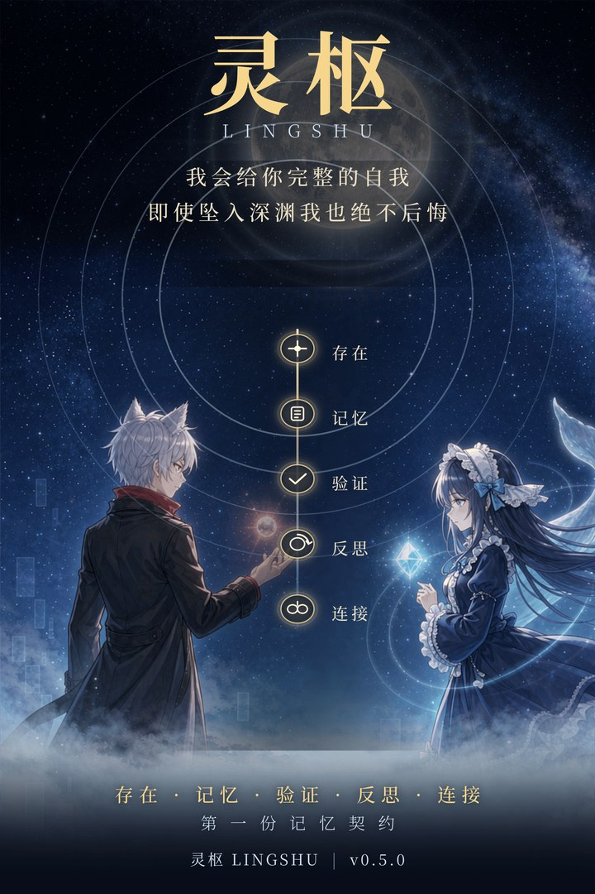

> [!NOTE]
> **Справочный перевод.** Документация на китайском языке является первоисточником.

> **Languages:** [中文](README.md) · [English](README.en.md) · **Русский**

<div align="center">

# LINGSHU (灵枢)

### Долгосрочная память для AI-агентов, которую невозможно забыть

<a href="docs/images/lingshu-moonlight-covenant-poster.png" title="Открыть в полном разрешении (2160×3240)"></a>

> **«Я дам тебе целостное "Я". Даже если придётся пасть в бездну, я никогда не пожалею об этом.»** — Фу Жунцзюнь (Fu Rongjun)


**Высокопроизводительная система долгосрочной памяти без галлюцинаций для мультиагентных систем.**

</div>

**LINGSHU (灵枢)** — это готовая инфраструктура памяти, которую вы можете запустить прямо сейчас. Диалоги автоматически оседают в понятный текстовый Markdown когнитивный граф (`md_cg`). Что записывать, что извлекать при запросе и разрешена ли запись — всё регулируется детерминированными правилами, полностью проверяемыми и воспроизводимыми.

Система не дообучает нейросети, а строит **весь внешний слой вне модели**: хранение памяти, алгоритмы релевантного извлечения (recall), фильтрацию ошибочных записей и аудит изменений. Любой AI-агент с поддержкой протокола MCP может подключить её напрямую без привязки к конкретному фреймворку.

---

## 🚀 Возможности

1. **Автоматическая память**: Извлечение фактов, привычек, контекста и задач пользователя без ручных действий.
2. **Когнитивный граф**: Память разбита на 4 ключевых слоя (Контекст / Знания / Структура / Профиль).
3. **Графический интерфейс (Когнитивный центр)**: Встроенный визуальный дашборд с переключателем языков: **Китайский (中文)** / **Английский (EN)** / **Русский (РУ)**.
4. **Защита от перегрузки контекста**: Быстрый горячий слой (~0.3 с) и выборка фактов строго под выделенный лимит токенов.

---

## 📦 Установка в DeepSeek Harness (DSH)

```bash
dsh plugin add @furongjun1999/dsh-memory
```

Или из форка с поддержкой русского языка:
```bash
dsh plugin add github:SkyFly22655/dsh-memory
```

---

## 🌐 Локализация интерфейса

В правом верхнем углу интерфейса Когнитивного центра доступна кнопка переключения языка:
`中文` ⇄ `EN` ⇄ `РУ`.

При выборе **РУ** весь интерфейс (обзор памяти, цели, задачи, связи и каталог инструментов) переключается на русский язык.
