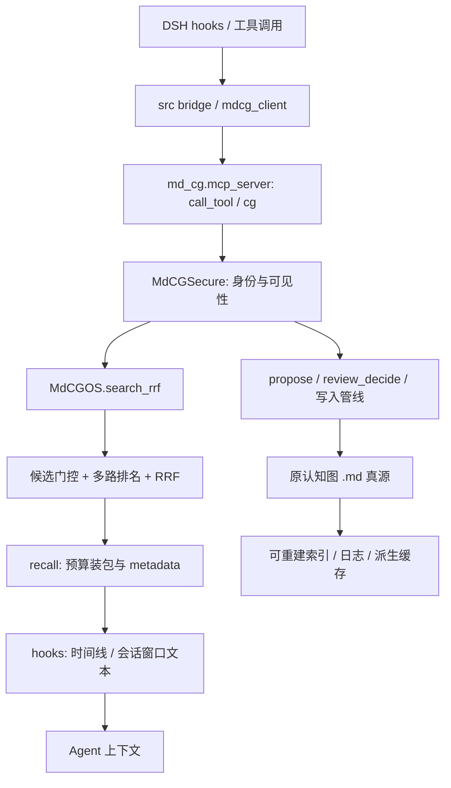

# Memory-RSI 研究报告 · 2026-10-12

> 续研更新：本文记录第一轮审计与实验。CSRE 的负条件和索引一致性缺口已在后续修复，状态与成本见 [续研验证](Memory-RSI_续研验证_20261012.md)；下文保留第一轮事实和实验口径。

本轮完成 Memory 核心审计、可复现的检索/交付诊断，以及复用原认知图的离线 Reflector、Verifier、Curator 原型。P2 实现的是有限候选策略比较与推荐，尚未实现自动提出代码修改的递归搜索。真实 Agent 的最终任务成功率、跨任务迁移和自然任务推理收益均未验证。

**结论：保留实验代码，继续默认关闭。** 查询片段选择在专门构造的长文尾部样例上有效，但公开状态链语料没有支持全面替换原交付逻辑；元数据占用预算还产生了负结果。当前证据不能判定整个系统只有一个主导瓶颈。

配套：[性能与实验报告](Memory-RSI_性能与实验_20261012.md)、[运行与集成说明](../mdcg/Memory-RSI_运行与集成_20261012.md)。完整原始结果随交付包的 `evidence/` 保存。

## 1. 版本、环境与研究范围

| 项目 | 本轮实际状态 |
|---|---|
| 基线 | `FuRongJun-1999/dsh-memory`，`76a1b7ba0579e8ce589e5f079b853e574735f822` |
| 分支 | `codex/memory-rsi-20261012`，由已有仓库创建独立 worktree |
| 开发目录 | `E:\Codex\2026-10-12\files-pasted-by-the-user-lingshu\work\dsh-memory-rsi` |
| Python | 复用现有 venv，Python 3.12.10；PATH 中的 WindowsApps 别名不能代表实际解释器 |
| Node / npm / Git | 24.16.0 / 11.13.0 / 2.54.0.windows.1 |
| Rust | cargo/rustc 1.99.0；本地构建 release 二进制后复核相关守卫 |
| DSH | 当前会话 PATH 未解析到 `dsh`；未重装、未替换正式插件、未改正式配置 |
| 数据 | 新建 E 盘隔离目录、合成轨迹、公开 hive-memory-bench；未读取或改写真实用户记忆 |
| 外部模型 | 未调用，无 API 消耗，无读者模型或模型裁判 |
| 修改面 | 新增 Python 实验模块、测试、文档；原 Memory 核心、原测试及 TypeScript 未改 |
| 发布 | 无 commit、push、PR、正式安装 |

主项目 `lingshu` 的完整世界模型运行时不属于本轮改造面；本报告最后只设计接口，不宣称已完成跨项目接入。论文资料核对截止 **2026-10-12**，不是对整个月未来发布的预判。

## 2. 实际调用链与已经存在的机制



| 文件 / 入口 | 核对结果及限制 |
|---|---|
| `mdcg.py`：`MdCG.add/search`、候选资格与层路由 | `.md` 节点是真源，索引是派生物；负记忆、目标槽与正排有不同语义。无条件上下文的搜索不等于完整情境匹配。 |
| `mdcos.py`：`search_rrf` | 默认词法、条件桶、实体、图、链、时间路径；fuzzy/semantic/goal 等受配置控制。每路按分数、重要度、ID 排序，1 基名次累加 `w/(60+rank)`；并列融合按 ID 稳定排序。 |
| `rrf_candidates.py` | 已有 `MDCG_RRF_CANDIDATES` 可选倒排候选层。本轮直接比较它，没有另造“Engram 索引”。小图中未证明速度收益。 |
| `consistency.py` | 已有分层判断与 ACCEPT/REJECT/DEFER/BLINDSPOT；扫描上限、条件与可见范围会限制发现矛盾的能力。不能据此保证任意事实冲突都能识别。 |
| `consolidate.py` | 已有反思、验证、grounding/replay、晋升和 before/after 演化留痕。某些路径改写现有节点；有来源关联不等于保留全部原文快照。 |
| `forgetting.py`、`protect.py` | 已有写入评估、冗余处理、保护与软删除/恢复机制；不能把低访问频次直接当错误知识，也不能绕过保护线。 |
| `freshness.py` | 复用唯一时间核，含衰减、刷新和保护下限。节点创建时间与事实生效时间不是同一概念；并非所有 RRF 路径使用同一新鲜度乘子。 |
| `sleep.py`、`sustain.py` | 已有周期维护、锁、shadow/git 与合并策略；维护循环不等于自主修改算法的 RSI。实验关闭后台循环。 |
| `mcp_server.py` | 原 `cg` 接口、令牌优先、匿名 guest、请求身份收窄与权限检查都已存在。新原型没有新增 MCP 工具或提升权限。 |
| `recall` 与 `src/hooks.ts` | recall 已返回 frontmatter、provenance、qualification、trust/verification 等信息；不能声称它完全丢掉元数据。但 hook 的时间线与会话窗口重新渲染为层/角色和前缀，相关时间、ID、条件未完整进入最终文本。 |

`recall` 默认总预算 1200、条目截断预算 250，但条目上限不是所有情况下的统一硬上限：完整条目仍放得下时会原样纳入，超出剩余预算才摘录。原始摘录采用前缀。hook 时间线另有逐项衰减预算与总预算，会话窗口又有自己的窗口预算；不能把其中一个预算代替整条 Agent 链路的实际 token 计量。

已阅读《[记忆系统架构优化：交付层瓶颈理论与设计](../mdcg/记忆系统架构优化_交付层瓶颈理论与设计_v0.1.md)》。其中 R-oracle/D-oracle 是待验证的定位方案，本轮实现了零模型诊断版本；该文提出的自然题与 reader 调用校准没有完成，不能用本轮合成题代替。

## 3. 已验证问题与优先级

| 优先级 | 证据 | 判定与本轮处理 |
|---|---|---|
| P0 | 公开状态链轨 63 题、270 段，RRF top-6 原文含现值比例仅 50.8% | 存在显著检索侧缺口。值字符串出现只是诊断代理，仍不是“答对”。原版与候选使用同一检索，不靠交付解决未召回部分。 |
| P0 | 专门覆盖长文尾部的合成留出题中，原版完整证据交付 16.7%，查询片段 87.5%；R-oracle 仍只有 16.7% | 此类样例的前缀交付损耗可复现；不外推为所有真实任务的主导瓶颈。 |
| P1 | `mine_fix_pairs` 将错误之后四条窗口内的命令当修复，不检查命令是否成功；默认直接写 knowledge | 失败命令也可形成修复“知识”。新原型要求有序且绑定 action/error 的工具检查，仅进入未验证审核候选。旧入口未被偷偷更改。 |
| P1 | 公开题 1200 预算下，metadata 交付现值出现率 42.9%，低于原版 47.6% | 负结果。元数据成本可挤掉内容，不能仅因溯源更完整就宣称质量更高；不接入生产 hook。 |
| P1（旧白箱路径） | CSRE 合成 SQLite 探针：负条件已命中仍返回；旧索引接受改过的库、甚至另一个库 | 缺少负条件门控与索引来源/版本绑定。已复现，但未证明它支配默认 `search_rrf` 热路径，因此未扩张本轮核心修改面。 |
| P2 | RRF 加权及并列探针差值至多 `1.15e-7`，返回分数只保留 6 位小数 | 属于舍入，不是已证实的融合排序错误。候选索引在所有合成比较中名次一致。 |
| P2 | neural 缺文件返回 False 且带 `load_index/FileNotFoundError` 结构化记录 | 当前已有可观测降级；旧审计提出的“静默失败”已部分被上游解决，本轮不重复实现。 |
| 测试可移植性 | `test_issue75_neural_failure` A11 精确匹配 LF；本机源码有 314 个 CRLF | 原版测试仍红，运行时 staticmethod 正常。保留失败日志和原测试，不把诊断替代测试通过。 |

主图索引的派生地位已经在代码中确立；旧 CSRE 缓存说明派生一致性仍须单独验证。本轮没有证明所有跨端同步、SQLite/MD 镜像或并发情形都不存在分叉。

## 4. 前沿研究核对与可借鉴范围

日期为 arXiv v1 / 本次页面所示最新修订。论文传播许可与源码许可分列；源码存在不等于训练或评测已复现。本轮没有复制外部项目代码，也没有引入它们的大型依赖。

| 研究与日期 | 代码与许可核对 | 对本项目的落点 |
|---|---|---|
| [Engram](https://arxiv.org/abs/2601.07372)，2026-01-12 / 07-12；论文 CC BY 4.0 | [官方仓库](https://github.com/deepseek-ai/Engram)，[Apache 2.0](https://github.com/deepseek-ai/Engram/blob/main/LICENSE)；demo 的 attention/MoE/mHC 使用占位形态，不等于完整生产训练栈 | 神经模型的 n-gram 查表与门控只能启发快速寻址。先复用现有候选索引，收益不成立就不另建缓存真源。 |
| [Gated DeltaNet](https://arxiv.org/abs/2412.06464)，2024-12-09 / 2025-03-06；论文 CC BY 4.0 | [NVlabs 原实现](https://github.com/NVlabs/GatedDeltaNet)采用 [Nvidia Source Code License-NC](https://github.com/NVlabs/GatedDeltaNet/blob/main/LICENSE)。[Qwen3-Next 官方说明](https://qwen.ai/blog?id=qwen3-next)使用其混合架构；不同实现许可须分别检查 | 参考保持/更新门的思想，外部知识仍须显式条件、证据和版本。原实现的非商业许可不能被误当 MIT，也不能据此推断所有 Qwen 实现的许可。 |
| [DeepSeek-V3 / MLA](https://arxiv.org/abs/2412.19437)，2024-12-27 / 2025-02-18；[V3.2 / DSA](https://arxiv.org/abs/2512.02556)，2025-12-02；论文均 arXiv 非独占传播许可 | 官方 [V3](https://github.com/deepseek-ai/DeepSeek-V3)、[V3.2](https://github.com/deepseek-ai/DeepSeek-V3.2)代码入口公开；本轮未逐文件核验这些实现的再分发许可，未移植代码 | MLA 压缩模型 KV，DSA 选择模型注意对象；不能等同于外部知识压缩。仅借鉴有限预算下的选择，且把实际渲染元数据计入预算。 |
| [ACE](https://arxiv.org/abs/2510.04618)，2025-10-06 / 2026-03-29；论文 CC BY 4.0 | [源码](https://github.com/ace-agent/ace)及 [Apache 2.0](https://github.com/ace-agent/ace/blob/main/LICENSE.txt)，本轮检出 `82709de050e1db6e6ef2f07bcb0393560b94992a`，阅读 generator/reflector/curator 与 playbook 更新代码 | 优先借鉴角色分离和增量更新。实际核对的 `apply_curator_operations` 路径执行 ADD，UPDATE/MERGE/DELETE 等仍列 TODO；不能从类注释推断所有操作已经实现。 |
| [MindMemOS](https://arxiv.org/abs/2608.12428)，2026-08-12；论文 CC BY 4.0 | 本轮未核实官方可运行代码入口和源码许可；这是证据缺口，不是声称其不存在 | 借鉴验证驱动结构调整、纠错与经验到技能。当前原型只做局部条件经验，不复现其演化搜索或技能学习结果。 |
| [Hindsight](https://arxiv.org/abs/2512.12818)，2025-12-14；论文 CC BY 4.0 | [官方实现](https://github.com/vectorize-io/hindsight)，[MIT](https://github.com/vectorize-io/hindsight/blob/main/LICENSE)；未安装或跑其模型评测 | 区分外界事实、经历和反思。原始轨迹归 contextual，知识候选走原 inbox，不另开权威 bank。 |
| [Titans](https://arxiv.org/abs/2501.00663)，2024-12-31；[MIRAS](https://arxiv.org/abs/2504.13173)，2025-04-17；论文 CC BY 4.0 | [Google 官方介绍](https://research.google/blog/titans-miras-helping-ai-have-long-term-memory/)为 2025-12-04；本轮未核实可直接复现论文的官方代码及许可，未采用第三方复现来冒充官方代码 | 测试时参数记忆、保留正则和更新目标属于模型层。用于梳理“写什么/何时更新/何时保留”，不把梯度遗忘移植成知识删除。 |
| [Mem-T](https://arxiv.org/abs/2601.23014)，2026-01-30 / 03-09；论文 CC BY 4.0 | [官方源码](https://github.com/yanweiyue/Mem-T)，[Apache 2.0](https://github.com/yanweiyue/Mem-T/blob/main/LICENSE)；README 仍说明训练脚本待发布，不能称完整训练复现条件齐备 | 密集反馈有助于把“命令出现”与“验证成功”分开。原型使用绑定的观察检查，没有做 RL 或 Mem-T 训练。 |
| [RSIAgent](https://arxiv.org/abs/2609.15364)，2026-09-14 / 09-18；论文 arXiv 非独占传播许可 | [官方仓库](https://github.com/AetherLabsAI/RSIAgent)，[Apache 2.0](https://github.com/AetherLabsAI/RSIAgent/blob/main/LICENSE)；未复现。README 对部分重试/预算口径有明确限定 | Curriculum/Actor/Verifier 与验证记忆值得参考。测试阶段冻结记忆，不能将更多重试或更多预算造成的收益归因于算法。 |
| [AIDE²](https://arxiv.org/abs/2609.26457)，2026-09-22；论文 arXiv 非独占传播许可 | 本轮未核实可运行官方 AIDE² 代码和许可；不把 AIDE 的公开代码当 AIDE² 完整实现 | 借鉴外层优化内层研究流程、独立验证及防评估投机。当前仅有限数据策略选择，不宣称复现自改代码循环。 |
| [Darwin Gödel Machine](https://arxiv.org/abs/2505.22954)，2025-05-29 / 2026-03-12；论文 CC BY 4.0 | [官方实现](https://github.com/kew-lab/darwin-godel-machine)，[Apache 2.0](https://github.com/kew-lab/darwin-godel-machine/blob/main/LICENSE)；未运行其完整搜索 | 候选档案、历史版本和独立任务评估。原型保留提案版本与失败结果，不无限循环、不改生产。 |
| [AI4AI-Bench](https://arxiv.org/abs/2608.20318)，2026-08-20；论文 CC BY 4.0 | [官方代码](https://github.com/Einsia/AI4AI-Bench)，[Apache 2.0](https://github.com/Einsia/AI4AI-Bench/blob/main/LICENSE)；资产许可独立。未运行其 GPU 训练协议 | 借鉴探索/正式测量分离、冻结评价、只跨边界传补丁。少量固定候选选择不等于证明新算法设计能力。 |

核对记录随包保存为 `evidence/research/sources.json`，含主链接、日期、传播许可、已核验的源码许可和内容哈希。GitHub API 曾返回限流，许可回退到官方 raw LICENSE；没有把 API 不可用解释为“项目无许可证”。

## 5. 最小原型：实现内容与边界

`memory_rsi.py` 的 `MemoryRSILab(enabled=False)` 默认拒绝运行；必须显式 `enabled=True`，且图根必须属于 `create_sandbox` 新建的实验目录。已有目录不能被该工厂直接认证为实验根。这是防误操作措施，不是对恶意本机进程的文件系统沙箱。

1. **Experience**：保存 scope、conditions 与 error/action/check 结构化事件，原始 JSON 写入同一图的 contextual 层，复用 `tool-output` 角色，默认不参与普通召回；哈希校验、确定性 ID 与重复写入幂等。
2. **Reflector**：只从按序关联的 error → action → tool check 提取局部修复候选。`passed` 必须为布尔 True；字符串、整数、失败、无关检查和 assistant 自报成功都不通过。失败原因分析只到检查失败或证据不足，不推断根因。
3. **Verifier**：同时核验来源哈希、事件关联、内容、条件、范围、可信度；不能给扩大后的结论继承旧证据。观察检查成立仍不是知识真值或外部轨迹真实性认证。
4. **Curator**：精确条件槽中的同动作经验去重、合并证据；同槽不同动作暂缓。新版本引用旧版本与原始轨迹，旧提案不覆盖。只调用原 `propose`，知识状态仍为 unverified；不自动接受。
5. **Strategy Optimizer**：最多 6 个预定义数据策略、1 轮 validation 选择、冻结后评估 holdout。输出 `accepted=False`，不执行候选脚本、不改代码、不修改评分器、不自动接入正式系统。
6. **回滚**：待审提案通过原 `review_decide(...,'reject')` 留痕撤销；策略通过停用实验调用回到原版。已人工接受的知识必须依原演化/审计流程人工处理，本原型没有“任意已接受节点自动恢复”的能力。

当前相似经验合并是**精确 error/conditions/scope/action 匹配**，冲突是同槽动作差异，尚无通用语义聚类、因果归因或任意事实纠错。可信度固定 0.5 是保守占位值，未经过概率校准。单轨迹最多 128 事件/64 KiB，冲突扫描最多 1000 节点加提案，超出即暂缓；这不是大规模库性能证明。

`evidence_delivery.py` 是单独的纯文本实验函数：按查询挑选原文窗口，返回字符偏移与源哈希；可将时间、来源、条件、verification、qualification 放入实际上下文字符串。没有生成摘要事实、修改 RRF 名次或移除门控。它也没有新增门控，原检索若返回 REJECT 注释，不能把此函数当过滤器。上线前还须经过既有 prompt safety 包装与真实 reader 验证。

## 6. 接受与暂缓的决定

保留离线原型、证据校验、审核队列复用与诊断工具。保留全部正负实验，不接受生产交付替换，不新建快速索引，不调整 RRF 默认权重，不自动改 freshness/forgetting。

公开状态链上 metadata 负结果表明：时间、来源和条件需要交付，但不能只做固定字段前置。后续应在同一 reader、真实 tokenizer 与固定总预算下，比较必要元数据选择、事实有效时间、证据组合与按需二次检索。未知题所有检索臂仍返回非空内容，拒答机制也没有被本轮修好。

## 7. 后续独立验证与世界模型接口（设计）

下一轮冻结未使用过的自然任务集、基础模型、reader 提示、裁判、工具权限、重试数和总预算，比较 A 原版、B 交付、C 经验候选、D 排序、E 已冻结策略。C 必须包含“相同 proposal-only 门控而不反思”的对照，防止把禁写带来的安全收益误算为学习收益。模型任务成功、错误接受、迁移和成本分别统计，不能只按原文保留率选胜者。

未来世界模型只向 Memory 提交带证据的观察，不直接覆写知识：

```json
{
  "observation_id": "world-event-id",
  "task_id": "task-id",
  "event_time": "事实发生时间",
  "recorded_at": "被记忆系统记录的时间",
  "scope": "环境与对象边界",
  "conditions": ["适用条件"],
  "prediction": "行动前的预测",
  "action_ref": "受权限控制的动作记录",
  "observed_outcome": "工具或环境实际回报",
  "evidence": [{"source_id": "receipt-id", "sha256": "原始回执哈希"}],
  "verification": {"status": "candidate", "independent_verifier": null}
}
```

Memory 返回 trace ID、候选 ID、审核状态、冲突与来源版本；决策方可请求更多证据，不能将“被存储”当作“已验证”。反思不得触发执行命令。该接口本轮仅设计，未连接世界模型，也未证明 AGI、通用持续学习或无限递归改进。
